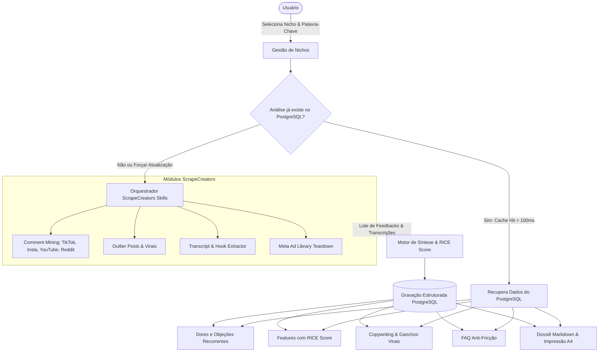

# PRD — Métrica Social-Media (Social Intelligence for App Builders)

**Versão:** 1.3  
**Data:** 11/11/2026  
**Status:** Aprovado e Alinhado com ScrapeCreators Skills + TRD  
**Autor:** Pair Programming (Antigravity + Leo-dev)  
**Documento Técnico Relacionado:** [TRD.md](file:///c:/Users/Leo-dev/Documents/Projetos/Metrica%20Social-Media/TRD.md)  
**Motor de Coleta de Dados:** [ScrapeCreators/social-media-research-skills](https://github.com/ScrapeCreators/social-media-research-skills)

---

## 1. Visão Geral e Propósito

### 1.1 Declaração do Problema
Fábricas de software, desenvolvedores independentes e agências de tecnologia frequentemente constroem aplicações, landing pages e SaaS baseados em "achismos" ou reuniões superficiais com stakeholders. Isso gera:
- Falta de Product-Market Fit (PMF) nas features entregues.
- Cópias e títulos de landing pages genéricos que não convertem.
- Desperdício de horas de engenharia desenvolvendo funcionalidades irrelevantes.
- Dificuldade em provar retorno de investimento (ROI) para clientes no momento da venda técnica.
- Bloqueio criativo na hora de escrever copys, ganchos e FAQs anti-objeção.

### 1.2 A Solução
O **Métrica Social-Media** é uma plataforma analítica de pesquisa de mercado e inteligência de produto. Integrado às skills especializadas do **ScrapeCreators** (`comment-mining`, `transcript-summarization`, `outlier-identification` e `ad-library-teardown`), o sistema orquestra a coleta de inteligência em redes sociais (TikTok, Instagram, YouTube, Reddit e Meta Ads) e transforma dados brutos em:
1. **Dores e Objeções Reais dos Usuários** (para priorização de backlog e arquitetura de dados).
2. **Features Validadas por Demanda com RICE Score** (Reach, Impact, Confidence e Effort calculados para cada funcionalidade).
3. **Headlines e Copywriting de Alta Conversão** (baseados nos termos, ganchos e transcrições de vídeos virais).
4. **FAQ Anti-Fricção** (as dúvidas críticas mais frequentes nos comentários que travam o checkout/venda).
5. **Dossiê Técnico em Markdown com Impressão Executiva** (relatório formatado para propostas comerciais de alto valor e entrega técnica).
6. **Base de Conhecimento Acumulativa por Nicho em PostgreSQL** (cache inteligente para consultas instantâneas e custo zero em buscas repetidas).

---

## 2. Público-Alvo e Personas no Modelo de Negócio

1. **Desenvolvedor / Product Engineer (Leo):**
   * *Necessidade:* Descobrir rapidamente o que os usuários de um determinado nicho (ex.: turismo de aventura, agendamentos, serviços locais) realmente precisam antes de escrever código ou modelar o banco de dados.
2. **Comercial / Vendas de Software e Sites:**
   * *Necessidade:* Gerar relatórios rápidos de auditoria para abordar leads corporativos em reuniões pré-venda, demonstrando falhas do mercado e justificando propostas comerciais de ticket elevado.
3. **Copywriter / Frontend Builder:**
   * *Necessidade:* Ter títulos de Hero e FAQs reais minerados diretamente de vídeos virais e anúncios concorrentes, eliminando o bloqueio criativo na montagem de landing pages.

---

## 3. Arquitetura de Coleta e Síntese de Dados

A extração social não depende de scrapers caseiros locais (que sofrem com bloqueios de IP e CAPTCHAs). A coleta é terceirizada para o ecossistema **ScrapeCreators** através de suas skills especializadas:

---

## 4. Casos de Uso do Negócio (Use Cases)

* **UC-01 (Auditoria Pré-Venda de Alto Valor):** Antes de uma reunião com cliente, o desenvolvedor roda uma pesquisa do nicho e gera o Dossiê Executivo impresso para levar à mesa como diferencial competitivo na proposta técnica.
* **UC-02 (Gestão de Nichos Temáticos):** Criação ou seleção de nichos (ex: *"Turismo de Aventura"*, *"Clínicas de Estética"*, *"SaaS Financeiro"*) para agrupar pesquisas e manter histórico unificado.
* **UC-03 (Pesquisa com Cache Inteligente):** Resposta imediata (< 100ms) direto do PostgreSQL quando um termo de um nicho já foi minerado anteriormente.
* **UC-04 (Mineração Completa com ScrapeCreators):** Disparo assíncrono das skills de comment mining, transcrição e análise de concorrentes nas redes públicas.
* **UC-05 (Alternância Sandbox / Modo Mock):** Testar layouts e demonstrações com conjunto de dados analíticos simulados sem consumo de créditos da API externa.
* **UC-06 (Exportação de Copywriting e FAQ):** Cópia rápida em 1 clique de títulos de Hero Section e perguntas frequentes para inserção direta no código da Landing Page.
* **UC-07 (Visualizador de Dossiê Markdown):** Visualização em abas (Renderizado com cards executivos vs. Raw Markdown com botão de cópia).
* **UC-08 (Impressão Técnica Formatada A4):** Acionamento da folha de estilos de impressão limpa, sem menus e sem quebra incorreta de tabelas, ideal para anexar em contratos.

---

## 5. Requisitos Funcionais (RF)

| ID | Nome | Descrição | Prioridade |
| :--- | :--- | :--- | :--- |
| **RF-01** | Gestão de Nichos | Criação, listagem e seleção de nichos temáticos no banco relacional. | Essencial (P0) |
| **RF-02** | Entrada de Termo / Concorrente | Input de palavra-chave, perfil ou hashtag do nicho a ser auditado. | Essencial (P0) |
| **RF-03** | Verificação de Cache | Consulta automática no PostgreSQL antes de disparar requisições externas. | Essencial (P0) |
| **RF-04** | Orquestração ScrapeCreators | Integração com a API do ScrapeCreators para execução das skills de mineração. | Essencial (P0) |
| **RF-05** | Mineração de Comentários | Extração de dúvidas e queixas de TikTok, Instagram, YouTube e Reddit. | Essencial (P0) |
| **RF-06** | Extração de Ganchos e Transcrições | Obtenção das falas iniciais de vídeos virais para títulos de Hero. | Alta (P1) |
| **RF-07** | Auditoria de Anúncios Concorrentes | Mapeamento de ofertas ativas na Meta Ad Library para o nicho. | Média (P2) |
| **RF-08** | Matriz de Features com RICE | Cálculo de Reach, Impact, Confidence e Effort para priorização de software. | Essencial (P0) |
| **RF-09** | FAQ Anti-Fricção | Seleção das 5 dúvidas mais repetidas nos comentários para landing pages. | Alta (P1) |
| **RF-10** | Visualizador Markdown (Tabs) | Visualização renderizada e editor de código raw com cópia rápida em 1 clique. | Essencial (P0) |
| **RF-11** | Impressão e PDF Executivo | Layout A4 limpo via `@media print` para exportação comercial. | Alta (P1) |
| **RF-12** | Persistência Relacional PostgreSQL | Armazenamento de nichos, análises, métricas RICE e dossiês versionados. | Essencial (P0) |

---

## 6. Requisitos Não-Funcionais (RNF)

* **RNF-01 (Eficiência de Custos e Cache):** Nenhuma requisição repetida ao ScrapeCreators deve ser feita se o termo já constar no banco de dados (exceto se o usuário forçar atualização).
* **RNF-02 (Conformidade com LGPD):** O sistema não armazena nomes, identificadores ou dados privados de usuários de redes sociais; apenas agrega dados analíticos e percentuais de sentimento.
* **RNF-03 (Resiliência de Scraping):** Falhas em uma rede social específica (ex: TikTok fora do ar) não devem abortar a síntese das demais fontes (Reddit, YouTube).
* **RNF-04 (Impressão A4 Impecável):** Relatório impresso deve ocultar navegação da UI e manter tabelas e callouts íntegros sem quebra de página no meio de cards (`break-inside: avoid`).
* **RNF-05 (Modularidade e Conteinerização Total):** Arquitetura desacoplada em monorepo com pastas independentes (`frontend/` e `backend/`), cada qual com seu próprio `Dockerfile`, orquestradas na raiz pelo `docker-compose.yml` junto ao PostgreSQL.

---

## 7. Métricas de Sucesso do Negócio

1. **Aumento do Ticket Médio:** Capacidade de cobrar de 2x a 3x mais por landing page ou sistema ao apresentar o Dossiê Técnico como diferencial de consultoria de vendas.
2. **Tempo de Criação Reduzido:** Redução do tempo de redação de títulos, ganchos e FAQs de horas para **menos de 5 minutos**.
3. **Assertividade de Backlog:** 100% das features de MVP de novos sistemas embasadas em dores mineradas e validadas pelo RICE Score.
4. **Economia Operacional:** Mais de 70% das consultas subsequentes atendidas pelo cache PostgreSQL com custo zero de API.
