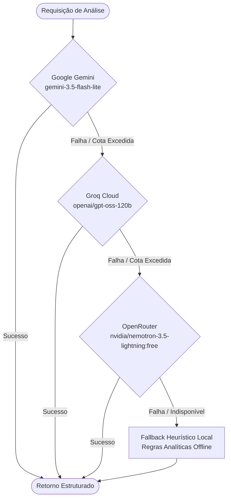

# Métrica Social-Media

> Plataforma de Inteligência de Mercado e Engenharia de Produto baseada em Mineração Social (TikTok, Instagram, YouTube, Reddit e Meta Ads) para Construtores de Software e Landing Pages.

[](https://fastapi.tiangolo.com)
[](https://vuejs.org)
[](https://www.postgresql.org)
[](https://tailwindcss.com)
[](https://www.docker.com)
[](https://typst.app)

---

## Visão Geral

Desenvolvedores, fundadores técnicos e agências de software frequentemente constroem aplicações, SaaS e landing pages baseados em suposições, resultando em baixo Product-Market Fit (PMF), propostas de valor genéricas e desperdício de horas de engenharia.

O **Métrica Social-Media** resolve esse gargalo automatizando a pesquisa de mercado através de mineração social em tempo real e orquestração de Inteligência Artificial. O sistema extrai e sintetiza comentários, postagens virais e discussões de clientes reais em:

- **Mapeamento de Dores Reais e Objeções**: Identificação de gargalos operacionais com métricas estatísticas de incidência, estimativa de impacto no negócio e citações literais extraídas de discussões públicas.
- **Backlog Priorizado com RICE Score**: Funcionalidades recomendadas com cálculo automático de *Reach*, *Impact*, *Confidence* e *Effort*, acompanhadas de *User Stories* e critérios de aceite detalhados no padrão INVEST.
- **Copywriting de Alta Conversão**: Ganchos emocionais categorizados por intenção (*social proof*, *relief*, *urgency*), variações para testes A/B e posicionamento estratégico de seções.
- **FAQ Anti-Fricção**: Objeções frequentes mapeadas por nível de fricção (1 a 5) com sugestões de resposta e dicas de posicionamento na página.
- **Dossiê Executivo e Exportação em PDF**: Relatório técnico completo visualizável em Markdown com diagramas Mermaid e exportação diagramada em alta precisão A4 via motor nativo Typst ou renderização client-side.
- **Base de Conhecimento Acumulativa em PostgreSQL**: Cache inteligente particionado por nicho, palavra-chave e modo de mineração (*mock* ou *live*), assegurando tempo de resposta inferior a 100ms para consultas já existentes.

---

## Arquitetura do Sistema

A solução adota uma arquitetura em monorepo desacoplada, conteinerizada e projetada para alta disponibilidade e resiliência:

```
┌─────────────────────────────────────────────────────────────┐
│                       Frontend (Vue 3)                      │
│      Vite + TypeScript + Tailwind CSS + Lucide Icons        │
│   • Dashboard Analítico       • Drawer de Detalhes          │
│   • Expansão Rápida de Busca  • Visualizador Markdown       │
│   • Exportação Typst/Client PDF (Diagramação A4)            │
└──────────────┬───────────────────────────────▲──────────────┘
               │ HTTP / JSON                   │
               ▼                               │
┌─────────────────────────────────────────────────────────────┐
│                      Backend (FastAPI)                      │
│            Python 3.11 + SQLAlchemy Assíncrono              │
│   • Router /api/v1/niches     • Router /api/v1/analyses     │
│   • Compilador de Dossiê      • Serviço Typst & PDF         │
│   • Pipeline Anti-Alucinação  • Cálculo Determinístico     │
└──────┬───────────────────────┬───────────────────────┬──────┘
       │                       │                       │
       ▼                       ▼                       ▼
┌──────────────┐      ┌─────────────────┐     ┌───────────────┐
│  PostgreSQL  │      │ ScrapeCreators  │     │   Multi-LLM   │
│   Cache &    │      │ Social Mining   │     │   Waterfall   │
│ Persistência │      │ (Reddit/TikTok) │     │   Failover    │
└──────────────┘      └─────────────────┘     └───────────────┘
```

### Motor Multi-LLM Waterfall (Failover em Cascata)

Para assegurar disponibilidade contínua sem depender de um único provedor, o orquestrador de IA implementa um padrão de tolerância a falhas em cascata com transição automática:



> [!NOTE]
> Se nenhuma chave de API estiver configurada ou se todos os provedores remotos esgotarem suas cotas, o **Fallback Heurístico Local** assume a geração instantaneamente, garantindo que o fluxo de trabalho nunca seja interrompido.

### Pipeline Anti-Alucinação e Métricas Determinísticas

Quando executado em modo `live` com a API ScrapeCreators configurada:
1. **Mineração de Discussões Reais**: O cliente busca postagens e comentários em fóruns e redes sociais (Reddit, TikTok, Instagram, YouTube) expandindo o termo de busca para focar em queixas e atritos operacionais.
2. **Cálculo Determinístico de Incidência**: As porcentagens de frequência das dores são calculadas matematicamente com base no volume exato de citações literais mineradas sobre o tamanho total da amostra.
3. **Persistência Completa de Metadados**: O banco armazena as citações de clientes (`sample_comments`), impacto financeiro, critérios de aceite (`acceptance_criteria`) e notas técnicas para auditoria.

---

## Estrutura do Repositório

```
Metrica Social-Media/
├── docker-compose.yml           # Orquestração dos serviços (db, backend, frontend)
├── PRD.md                       # Product Requirements Document
├── TRD.md                       # Technical Requirements Document
├── CHANGELOG.md                 # Histórico cronológico de versões e correções
├── .env.example                 # Modelo de variáveis de ambiente
├── backend/
│   ├── Dockerfile
│   ├── requirements.txt         # Dependências FastAPI, SQLAlchemy, Typst, httpx
│   └── app/
│       ├── main.py              # Ponto de entrada da API e configuração de CORS
│       ├── api/v1/
│       │   ├── analyses.py      # Endpoints de criação, cache e consulta de análises
│       │   └── niches.py        # Endpoints de gerenciamento de nichos
│       ├── core/
│       │   ├── config.py        # Validação de configurações com Pydantic Settings
│       │   └── database.py      # Conexão assíncrona SQLAlchemy (asyncpg)
│       ├── models/              # Modelos relacionais (Niche, Analysis, PainPoint, etc.)
│       ├── schemas/             # Contratos de dados Pydantic v2
│       └── services/
│           ├── dossier_compiler.py  # Compilador de relatórios técnicos em Markdown
│           ├── llm_orchestrator.py  # Orquestrador Multi-LLM resiliente
│           ├── pdf_service.py       # Renderização de PDF via WeasyPrint
│           ├── typst_service.py     # Compilação diagramada em PDF via Typst
│           └── scrapecreators/      # Integração e cliente de mineração social
└── frontend/
    ├── Dockerfile
    ├── package.json
    ├── tailwind.config.ts
    ├── vite.config.ts
    └── src/
        ├── App.vue              # Dashboard principal com métricas e filtros rápidos
        ├── main.ts              # Inicialização Vue 3
        ├── components/
        │   ├── DetailDrawer.vue # Painel lateral detalhado com citações literais
        │   └── MarkdownViewer.vue # Visualizador de dossiê com exportação PDF
        ├── services/
        │   └── api.ts           # Cliente HTTP Axios tipado
        └── types/
            └── index.ts         # Definições de tipos TypeScript
```

---

## Pré-requisitos

- [Docker](https://www.docker.com/) e Docker Compose (recomendado para execução padrão)
- **Opcional para execução nativa:**
  - Python 3.11+
  - Node.js 18+ e npm / pnpm
  - Instância local do PostgreSQL 16+

---

## Configuração do Ambiente

1. Clone o repositório ou navegue até o diretório raiz do projeto.
2. Copie o arquivo de exemplo para criar a sua configuração local:

```bash
cp .env.example .env
```

3. Configure os parâmetros essenciais no `.env`:

```ini
# Banco de Dados PostgreSQL
POSTGRES_DB=metrica_social
POSTGRES_USER=postgres
POSTGRES_PASSWORD=postgres
POSTGRES_PORT=5433
DATABASE_URL=postgresql+asyncpg://postgres:postgres@db:5432/metrica_social

# Configurações do Backend
ENVIRONMENT=development
BACKEND_PORT=8000
DEFAULT_MINING_MODE=mock  # 'mock' para dados simulados ou 'live' para mineração real

# Chaves de API para Síntese Multi-LLM (Opcionais com Fallback Automático)
GEMINI_API_KEY=your_gemini_api_key_here
GEMINI_MODEL=gemini-3.5-flash-lite

GROQ_API_KEY=your_groq_api_key_here
GROQ_MODEL=openai/gpt-oss-120b

OPENROUTER_API_KEY=your_openrouter_api_key_here
OPENROUTER_MODEL=nvidia/nemotron-3.5-lightning:free

# ScrapeCreators (Necessário apenas para mineração real em modo 'live')
SCRAPECREATORS_API_KEY=
SCRAPECREATORS_BASE_URL=https://api.scrapecreators.com

# Frontend
VITE_API_URL=http://localhost:8000/api/v1
FRONTEND_PORT=5173
```

> [!TIP]
> A porta do PostgreSQL no host está padronizada como `5433` para evitar conflitos com instâncias de banco já em execução no sistema operacional. A rede interna do Docker se comunica normalmente pela porta padrão `5432`.

---

## Executando com Docker Compose

Suba o ecossistema completo com um único comando:

```bash
docker compose up -d --build
```

### Serviços Inicializados:

| Serviço | Contêiner | Porta Externa | Descrição |
| :--- | :--- | :--- | :--- |
| **Frontend** | `metrica_social_frontend` | `http://localhost:5173` | Dashboard Vue 3 + Tailwind |
| **Backend** | `metrica_social_backend` | `http://localhost:8000` | API FastAPI com recarregamento dinâmico |
| **PostgreSQL** | `metrica_social_db` | `localhost:5433` | Banco de dados relacional e cache |

Para acompanhar os logs de execução:

```bash
docker compose logs -f backend
```

Para interromper a execução:

```bash
docker compose down
```

---

## Execução em Desenvolvimento Local (Sem Docker)

### 1. Backend

```bash
cd backend
python -m venv venv
source venv/bin/activate  # No Windows: .\venv\Scripts\activate
pip install -r requirements.txt
uvicorn app.main:app --host 0.0.0.0 --port 8000 --reload
```

A documentação interativa Swagger estará disponível em: `http://localhost:8000/docs`.

### 2. Frontend

```bash
cd frontend
npm install
npm run dev
```

Acesse a interface em: `http://localhost:5173`.

---

## Rotas Principais da API

### Nichos (`/api/v1/niches`)
- `GET /api/v1/niches`: Lista todos os nichos cadastrados com estatísticas de análises vinculadas.
- `POST /api/v1/niches`: Registra um novo nicho no sistema.

### Análises (`/api/v1/analyses`)
- `POST /api/v1/analyses`: Executa uma nova pesquisa ou recupera a análise em cache caso já exista para o nicho, palavra-chave e modo informados.
  - Parâmetros: `niche_id`, `keyword`, `sources`, `force_refresh`, `mode`.
- `GET /api/v1/analyses/{analysis_id}/dossier`: Retorna o Dossiê Executivo completo formatado em Markdown.
- `GET /api/v1/analyses/{analysis_id}/pdf`: Gera e realiza o download do documento técnico em PDF de alta resolução diagramado via Typst.

---

## Exportação de Dossiês

A plataforma oferece dois métodos complementares de exportação do relatório técnico:

1. **PDF de Alta Precisão Tipográfica (Typst Engine):** Compilado no backend usando a linguagem tipográfica moderna [Typst](https://typst.app), gerando documentos A4 com diagramação editorial profissional, cabeçalhos, rodapés, paginação contextualizada e tabela RICE documentada.
2. **Impressão Client-Side (HTML / Canvas):** Renderizado no navegador via `html2pdf.js` para download instantâneo sem sobrecarga de rede.
