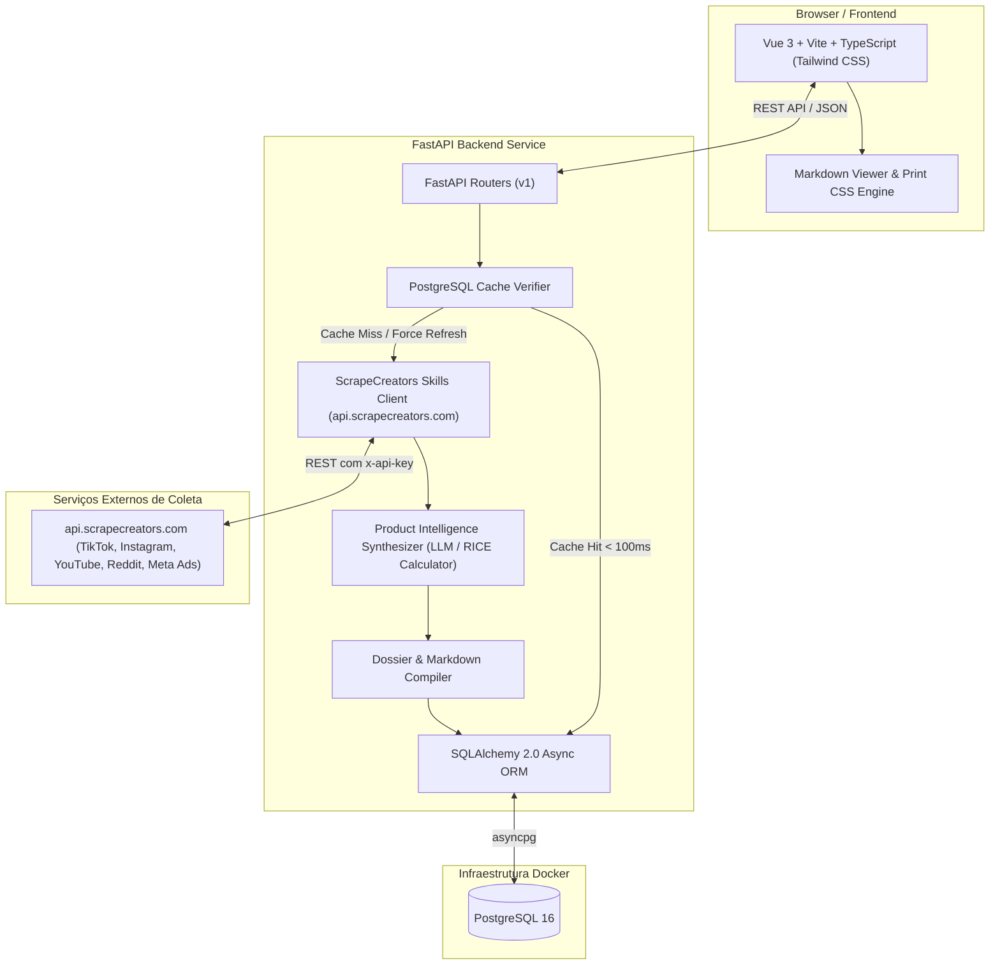
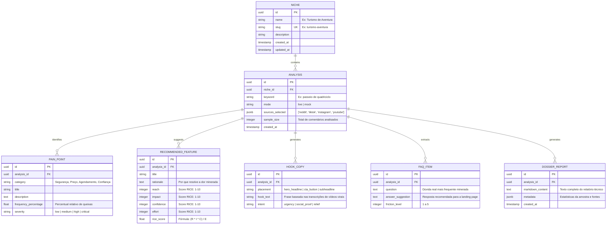

# TRD — Métrica Social-Media (Social Intelligence for App Builders)

**Versão:** 1.2  
**Data:** 11/11/2026  
**Status:** Aprovado para Implementação com ScrapeCreators Skills Engine  
**Autor:** Pair Programming (Antigravity + Leo-dev)  
**Documento Relacionado:** [PRD.md](file:///c:/Users/Leo-dev/Documents/Projetos/Metrica%20Social-Media/PRD.md)  
**Repositório Base de Skills:** [ScrapeCreators/social-media-research-skills](https://github.com/ScrapeCreators/social-media-research-skills)

---

## 1. Visão Geral da Arquitetura

O sistema é desenhado como uma plataforma desacoplada conteinerizada via **Docker Compose**:
- **Frontend SPA:** Vue 3 (Composition API, `<script setup>`), Vite, TypeScript, Tailwind CSS, com renderizador de Markdown e motor de impressão técnica executiva A4.
- **Backend API:** FastAPI (Python 3.11+), Pydantic v2, SQLAlchemy 2.0 (assíncrono com `asyncpg`), camada de cache PostgreSQL e integrador de Skills do **ScrapeCreators**.
- **Motor de Coleta Social (ScrapeCreators Integration):** Módulo cliente que consome as APIs públicas de extração social (`api.scrapecreators.com`) via skills de `comment-mining`, `transcript-summarization`, `outlier-posts` e `ad-library-teardown`.
- **Banco de Dados:** PostgreSQL 16 para persistência estruturada de nichos, pesquisas cacheadas, métricas RICE, copys, FAQs e relatórios versionados.



---

## 2. Especificação da Integração com ScrapeCreators

### 2.1 Módulos / Skills Utilizados
O backend FastAPI orquestra as seguintes capacidades mapeadas do repositório `ScrapeCreators/social-media-research-skills`:

1. **`comment-mining` (`skills/comment-mining`):**
   - Extrai em lote comentários públicos e respostas de TikTok, Instagram, YouTube e Reddit para o nicho pesquisado.
   - Fornece volume de queixas, dúvidas pré-compra e vocabulário natural do público-alvo.
2. **`transcript-summarization` (`skills/transcript-summarization`):**
   - Obtém a transcrição de áudio dos vídeos que se tornaram virais no nicho.
   - Extrai os ganchos (hooks) dos primeiros segundos de fala para geração dos títulos de Hero Section.
3. **`ad-library-teardown`:**
   - Consulta a biblioteca pública de anúncios da Meta procurando anúncios ativos de concorrentes no nicho para mapear argumentos de venda que estão funcionando.
4. **`mock-collector` (Resiliência e Desenvolvimento Local):**
   - Adaptador interno para rodar a aplicação em ambiente de desenvolvimento sem consumir chamadas da API do ScrapeCreators.

### 2.2 Estrutura do Pacote de Serviços do Backend
```text
backend/app/services/
├── scrapecreators/
│   ├── client.py           # Cliente HTTP assíncrono (httpx) para api.scrapecreators.com
│   ├── comment_miner.py    # Wrapper da skill de comment-mining
│   ├── transcript_miner.py # Wrapper da skill de transcrições e ganchos
│   ├── ad_miner.py         # Wrapper da auditoria da Meta Ad Library
│   └── mock_miner.py       # Dados analíticos simulados para sandbox
├── synthesis/
│   ├── rice_calculator.py  # Algoritmo de cálculo de RICE Score
│   ├── clusterizer.py      # Agrupamento semântico de dores e objeções
│   └── compiler.py         # Montador do Dossiê Técnico em Markdown
└── cache_service.py        # Verificação e invalidação de cache PostgreSQL
```

---

## 3. Modelo de Dados Relacional (PostgreSQL)



---

## 4. Endpoints da API REST (v1)

- `GET /api/v1/niches` — Lista nichos com contagem de pesquisas e última atividade.
- `POST /api/v1/niches` — Cria um novo nicho temático.
- `GET /api/v1/niches/{niche_id}` — Retorna detalhes do nicho e histórico de análises.
- `POST /api/v1/analyses` — Executa ou recupera uma análise:
  ```json
  {
    "niche_id": "uuid",
    "keyword": "passeio de quadriciclo",
    "sources": ["tiktok", "instagram", "youtube", "reddit"],
    "force_refresh": false,
    "mode": "live"
  }
  ```
  * *Comportamento:* Se `force_refresh=false` e já existir registro no PostgreSQL, retorna o resultado cacheado em < 100ms. Caso contrário, aciona o ScrapeCreators, sintetiza os dados, grava no banco e retorna.
- `GET /api/v1/analyses/{analysis_id}` — Retorna os insights estruturados (Dores, RICE, Copies, FAQs).
- `GET /api/v1/analyses/{analysis_id}/dossier` — Retorna exclusivamente o Markdown estruturado do Dossiê Técnico para o visualizador e impressão A4.

---

## 5. Módulo de Markdown Preview & Impressão Técnica

### 5.1 Especificações do Visualizador Frontend
- **Abas de Controle:**
  - *Modo Dossiê Executivo (Renderizado):* Cards de métricas, tabelas de RICE Score, badges de severidade e ganchos em destaque.
  - *Modo Raw Markdown:* Editor/visualizador monoespaçado com botão de **"Copiar Markdown para Clipboard"** (1-click copy).
- **Estilos de Impressão (`@media print`):**
  - Ocultação automática de menus, barras de navegação e botões.
  - Cabeçalho formal com metadados do projeto e carimbo de data/hora.
  - Regra CSS `break-inside: avoid` em cards e tabelas para garantir impressão A4 perfeita.

---

## 6. Estrutura de Diretórios do Projeto (Monorepo Desacoplado)

O projeto adota uma estrutura totalmente desacoplada, com pastas independentes para `frontend/` e `backend/`, cada uma possuindo seu próprio `Dockerfile`, scripts de inicialização e dependências, orquestradas na raiz pelo `docker-compose.yml`:

```text
Metrica Social-Media/
├── docker-compose.yml               # Orquestrador dos serviços (frontend, backend, db)
├── .env.example                     # Modelo de variáveis de ambiente para os containers
├── .env                             # Variáveis de ambiente locais (ignorado no git)
├── .gitignore                       # Ignora node_modules, __pycache__, volumes, .env
├── README.md                        # Documentação rápida de execução (quickstart)
├── PRD.md                           # Product Requirements Document
├── TRD.md                           # Technical Requirements Document
│
├── backend/                         # Serviço de API e Mineração (FastAPI + Python 3.11+)
│   ├── Dockerfile                   # Build do container FastAPI com uvicorn
│   ├── requirements.txt             # Dependências Python (fastapi, uvicorn, sqlalchemy, asyncpg, httpx...)
│   ├── alembic.ini                  # Configuração de migrações de banco
│   ├── alembic/                     # Scripts de versionamento do esquema PostgreSQL
│   │   ├── env.py
│   │   └── versions/
│   └── app/
│       ├── main.py                  # Ponto de entrada FastAPI (CORS, lifespan, routers)
│       ├── core/
│       │   ├── config.py            # Leitura de variáveis do .env via Pydantic Settings
│       │   └── database.py          # Engine assíncrona SQLAlchemy e get_db session
│       ├── models/                  # Modelos relacionais SQLAlchemy 2.0
│       │   ├── __init__.py
│       │   ├── niche.py             # Modelo Niche
│       │   ├── analysis.py          # Modelo Analysis
│       │   ├── pain_point.py        # Modelo PainPoint
│       │   ├── feature.py           # Modelo RecommendedFeature
│       │   ├── hook.py              # Modelo HookCopy
│       │   ├── faq.py               # Modelo FaqItem
│       │   └── dossier.py           # Modelo DossierReport
│       ├── schemas/                 # Schemas de validação e serialização Pydantic v2
│       │   ├── __init__.py
│       │   ├── niche.py
│       │   ├── analysis.py
│       │   └── dossier.py
│       ├── api/
│       │   └── v1/                  # Endpoints versionados
│       │       ├── __init__.py
│       │       ├── router.py        # Agregador de rotas v1
│       │       ├── niches.py        # Rotas CRUD de Nichos
│       │       ├── analyses.py      # Disparo e consulta de análises com cache
│       │       └── dossiers.py      # Consulta e exportação de Markdown
│       └── services/                # Regras de Negócio e Coleta
│           ├── cache_service.py     # Verificação de Cache Hit no PostgreSQL
│           ├── synthesis_service.py # Cálculo de RICE Score e consolidação de insights
│           ├── dossier_compiler.py  # Gerador do Markdown formatado para impressão
│           └── scrapecreators/      # Integração com as Skills do ScrapeCreators
│               ├── __init__.py
│               ├── client.py        # Cliente HTTP assíncrono para api.scrapecreators.com
│               ├── comment_miner.py # Skill: Comment Mining
│               ├── transcript_miner.py # Skill: Transcript & Hook Extraction
│               ├── ad_miner.py      # Skill: Meta Ad Library Teardown
│               └── mock_miner.py    # Dados analíticos simulados para sandbox/testes
│
└── frontend/                        # Interface SPA (Vue 3 + Vite + Tailwind CSS)
    ├── Dockerfile                   # Build do container Vue (Node em dev ou Nginx multi-stage)
    ├── package.json                 # Dependências (vue, vite, tailwindcss, lucide-vue-next, markdown-it...)
    ├── vite.config.ts               # Configuração do Vite e proxy reverso para backend
    ├── tsconfig.json                # Configuração TypeScript
    ├── tailwind.config.ts           # Configuração de temas, cores e fontes
    ├── postcss.config.js
    ├── index.html                   # HTML base com fontes e metadados
    └── src/
        ├── main.ts                  # Ponto de entrada Vue
        ├── App.vue                  # Componente raiz
        ├── assets/
        │   ├── main.css             # Diretivas do Tailwind CSS
        │   └── print.css            # Folha de estilos dedicada para impressão A4 (@media print)
        ├── components/              # Componentes visuais reutilizáveis
        │   ├── common/
        │   │   ├── Navbar.vue       # Barra de navegação e seleção de Nicho
        │   │   ├── StatusBadge.vue  # Badges de severidade e tags
        │   │   └── LoadingState.vue # Indicador de etapas da mineração social
        │   ├── analysis/
        │   │   ├── SearchBar.vue    # Input de palavra-chave, toggles de redes e modo mock
        │   │   ├── PainPointsGrid.vue # Cards de dores e percentual de incidência
        │   │   ├── FeatureRiceTable.vue # Tabela com ordenação por RICE Score
        │   │   ├── MarketingHooks.vue # Ganchos virais com 1-click copy
        │   │   └── FaqAccordion.vue # Perguntas frequentes anti-fricção
        │   └── dossier/
        │       ├── MarkdownViewer.vue # Visualizador com abas (Renderizado vs. Raw)
        │       └── PrintDossier.vue # Template formatado para geração de PDF executivo
        ├── views/                   # Páginas da aplicação
        │   ├── DashboardView.vue    # Visão principal analítica
        │   ├── NichesView.vue       # Gestão de Nichos e histórico acumulado
        │   └── DossierView.vue      # Visualização dedicada do relatório técnico
        ├── services/                # Comunicação com o Backend FastAPI (Axios/Fetch)
        │   ├── api.ts               # Instância base HTTP
        │   ├── nicheService.ts
        │   └── analysisService.ts
        └── types/                   # Contratos de dados e interfaces TypeScript
            ├── niche.ts
            ├── analysis.ts
            └── dossier.ts
```

---

## 7. Configuração de Variáveis de Ambiente (`.env`)

```env
# Backend & Database
DATABASE_URL=postgresql+asyncpg://postgres:postgres@db:5432/metrica_social
POSTGRES_DB=metrica_social
POSTGRES_USER=postgres
POSTGRES_PASSWORD=postgres

# ScrapeCreators Engine
SCRAPECREATORS_API_KEY=sua_chave_aqui
DEFAULT_MINING_MODE=mock # 'mock' para desenvolvimento, 'live' para produção

# LLM Synthesis Engine (OpenAI, Gemini ou Groq)
SYNTHESIS_API_KEY=sua_chave_llm
SYNTHESIS_MODEL=gpt-4o-mini # ou gemini-1.5-flash
```

---

## 8. Critérios de Aceite Técnico (DoD)

1. [ ] `docker compose up` inicia os 3 containers (`backend`, `frontend`, `db`) sem erros.
2. [ ] Banco de dados PostgreSQL armazena nichos e análises preservando a integridade referencial.
3. [ ] Pesquisa em modo `mock` responde em menos de 1 segundo; consulta repetida com cache hit responde em menos de 100ms.
4. [ ] Chamada em modo `live` integra com as rotas do ScrapeCreators (`comment-mining`, `transcript-summarization`), normalizando o JSON de resposta.
5. [ ] Frontend em Vue 3 exibe o painel analítico interativo com cálculo de RICE Score e visualizador de Dossiê.
6. [ ] Ação de "Imprimir Dossiê" gera visualização em A4 profissional, sem cabeçalhos de navegador ou botões residuais na tela.
